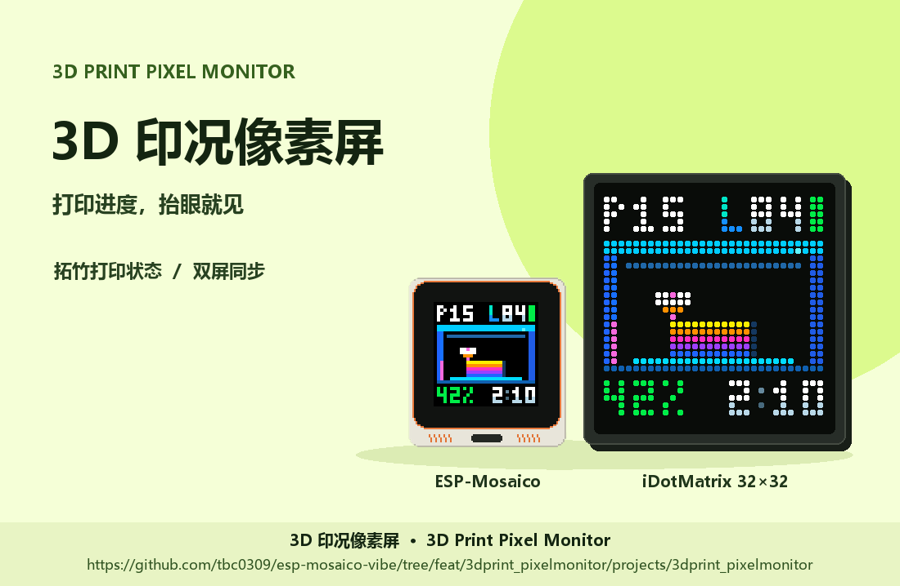

# 3D 印况像素屏 · 3D Print Pixel Monitor



[功能介绍 / Overview](docs/listing.md) · [32×32 像素屏图集 / Pixel display gallery](docs/PIXEL_DISPLAYS.md)

This ESP32-S31 app monitors Bambu Lab printers and displays the existing 32×32
pixel animations on the 480×480 ESP-Mosaico display. It can independently drive
a supported 32×32 iDotMatrix panel over BLE. Both displays consume the same
printer state, layout and idle policy.

1. Install the application through ESP-Mosaico Vibe Mode using the System Update bundle.
2. On initial setup, join the board's `PrintPixel-xxxxxx` network with password
   `12345678` and open `http://192.168.4.1/`. After Wi-Fi setup, use the address shown
   along the bottom of the display. Change the initial admin password on first login.
3. Add a LAN printer or Bambu Lab cloud account in the browser. The board's
   display operates independently of the external panel binding.
4. To drive the external panel, enable linking in Pixel Display settings, scan
   or enter its MAC, and enter its password if configured. Disconnect other
   BLE controllers from that panel before binding.

## Build and package

Initialize the pinned BSP and utils submodules from the workspace root. Use the
workspace-pinned ESP-IDF commit `7b9cc1ac79f865983f59bb8ff3ff43eb74ff1dbe`
for ESP32-S31. Activate that environment and install the ESP-Iris host
requirements from `submodule/esp-mosaico-utils/ESP-Iris/components/esp_iris/tools/requirements.lock`.
Set `ESP_IRIS_PYTHON` to that Python executable before CMake configuration.
Run the following commands from the repository root.

### Application image · `3dprint_pixelmonitor.bin`

```sh
idf.py --preview -D CONFIGDEP_ENABLE=OFF -C projects/3dprint_pixelmonitor build
```

The build writes `projects/3dprint_pixelmonitor/build/3dprint_pixelmonitor.bin`.
Use it for an application-only update on a device with a compatible partition layout.

### Vibe Mode bundle · `3dprint_pixelmonitor.irisfw`

```sh
idf.py --preview -D CONFIGDEP_ENABLE=OFF -C projects/3dprint_pixelmonitor system-update-bundle
```

The target writes `projects/3dprint_pixelmonitor/build/3dprint_pixelmonitor-system-update.irisfw`.
The release publishes it as `3dprint_pixelmonitor.irisfw`. Use Vibe Mode to install it
on a device with Vibe Mode already present. The tested board previously rolled back
after an in-app OTA update to the alternate slot, so use the Vibe Mode bundle to update.

### Standalone flash image · `3dprint_pixelmonitor-full.bin`

After building the application, merge the bootloader, partition table, initial OTA data
and application. The offsets and flash settings below come from this board's
`build/flasher_args.json`. Use the generated values if you change the partition layout.

```sh
cd projects/3dprint_pixelmonitor
python -m esptool --chip esp32s31 merge-bin \
  --output build/3dprint_pixelmonitor-full.bin --target-offset 0x0 \
  --flash-mode dio --flash-size 16MB --flash-freq 80m \
  0x2000 build/bootloader/bootloader.bin \
  0x8000 build/partition_table/partition-table.bin \
  0x9000 build/ota_data_initial.bin \
  0x210000 build/3dprint_pixelmonitor.bin
```

Write `build/3dprint_pixelmonitor-full.bin` at `0x0` in ROM Download Mode.
This image can be generated for a blank board without Vibe Mode. The write
overwrites any existing Vibe Mode installation and settings in the covered
flash region. The image layout has been verified. Boot on a blank board has yet to be tested.

The bridge implementation is ported from iDotMatrix × Bambu Lab at
`658f8cc24dcd647e26c7296500aeff7bbcbf8c30`. Its license and attribution are
included with the imported component.
